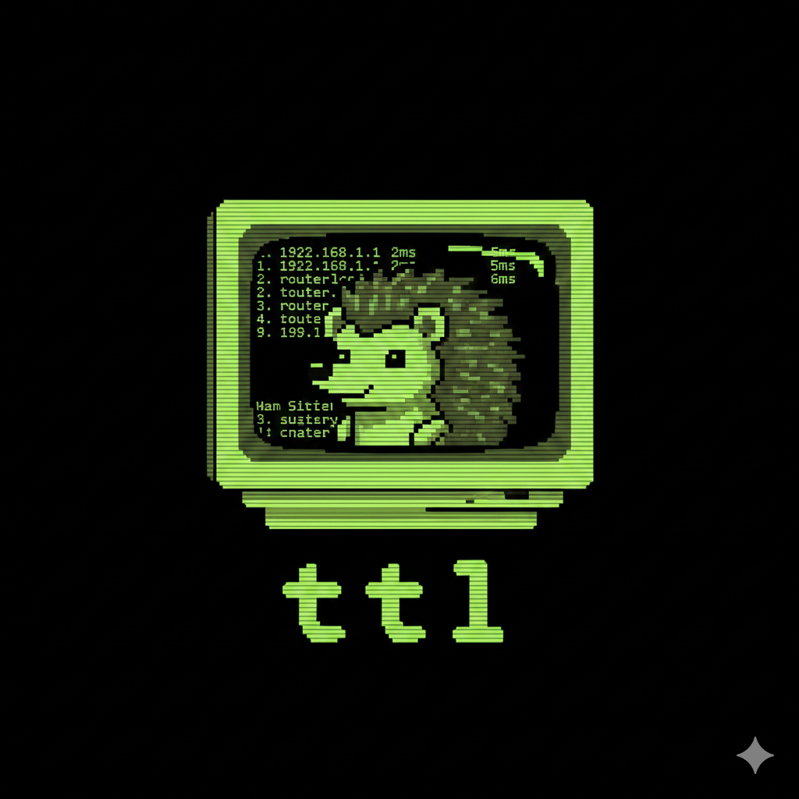
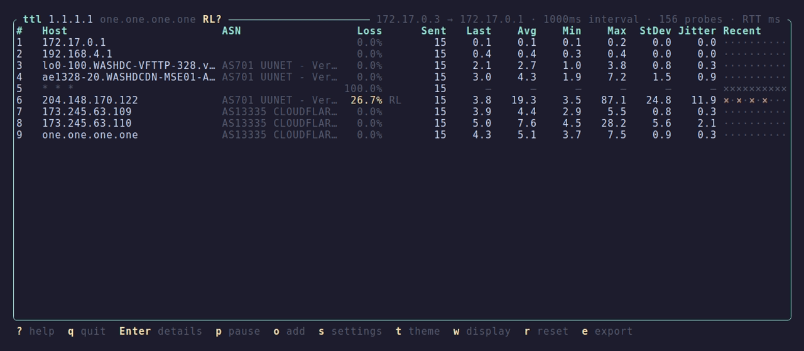

<p align="center">
  
</p>

# ttl

[](https://crates.io/crates/ttl)
[](https://github.com/lance0/ttl/actions/workflows/ci.yml)
[](LICENSE-MIT)
[](https://ko-fi.com/lance0)

**Network diagnostic tool that goes beyond traceroute: MTU discovery, NAT detection, route flap alerts, IX identification, and more.**

ttl traces the path to one or more hosts continuously, keeps per-hop loss,
latency and jitter statistics, and flags what it finds along the way. Use it as
an interactive TUI, or run it headless with JSON, CSV, text report, streaming
JSON, or Prometheus output.

[Documentation](docs/README.md) · [Install](#install) ·
[Releases](https://github.com/lance0/ttl/releases) · [Changelog](CHANGELOG.md)

<p align="center">
  
</p>

## Quick start

```bash
cargo install ttl                                # or: brew install ttl
sudo setcap cap_net_raw+ep "$(command -v ttl)"   # Linux; on macOS/BSD run ttl with sudo

ttl 8.8.8.8                          # live TUI; press ? for keys
ttl 8.8.8.8 1.1.1.1 9.9.9.9          # several targets; Tab switches
ttl -p udp --flows 8 cloudflare.com  # ECMP path discovery
ttl 1.1.1.1 -c 100 --report          # 100 rounds, then a text report
```

Run `ttl` with no target to open an empty session and add targets with `o`.

## What it finds

<a id="features"></a>
<a id="real-world-use-cases"></a><a id="usage-examples"></a><a id="interactive-tui"></a><a id="report-and-export"></a><a id="advanced-options"></a>
<a id="find-mtu-blackholes-in-vpns"></a><a id="detect-carrier-grade-nat-breaking-your-flows"></a><a id="identify-internet-exchange-points"></a><a id="catch-flapping-routes"></a>
<a id="detect-transparent-proxies"></a><a id="distinguish-real-loss-from-icmp-rate-limiting"></a><a id="compare-multiple-paths"></a><a id="trace-all-resolved-ips-round-robin-dns"></a>

- **MTU blackholes** in VPNs and tunnels: `--pmtud` binary-searches the largest
  packet that reaches the destination. [Path MTU Discovery](docs/FEATURES.md#path-mtu-discovery-pmtud)
- **Load-balanced paths**: `-p udp --flows N` enumerates ECMP paths and tells
  per-flow from per-packet balancing. [Multi-flow ECMP](docs/FEATURES.md#multi-flow-ecmp-detection-parisdublin-traceroute)
- **NAT rewriting your flows**, including carrier-grade NAT, shown as `NAT`.
  [NAT Detection](docs/FEATURES.md#nat-detection)
- **Rate limiting vs real loss**: the `RL?` title flag and `RL` loss tag mark routers that throttle
  ICMP replies rather than drop traffic. [Detection Indicators](docs/FEATURES.md#detection-indicators)
- **Flapping routes**: `!` marks a hop whose responder changed, kept apart
  from expected ECMP (`E`). [Route Flap Detection](docs/FEATURES.md#route-flap-detection)
- **Transparent proxies and asymmetric paths**: `TTL!` and `ASYM`.
  [Detection Indicators](docs/FEATURES.md#detection-indicators)
- **Who runs each hop**: ASN, reverse DNS, GeoIP, and Internet Exchange
  points from PeeringDB. [Enrichment Lookups](docs/FEATURES.md#enrichment-lookups)
- **MPLS labels and router interfaces** from ICMP extensions (RFC 4950,
  RFC 5837), marked `+`. [ICMP Extension Details](docs/FEATURES.md#icmp-extension-details)
- **Differences between paths**: trace several targets, or every address a
  name resolves to with `--resolve-all`. [Multi-IP Resolution](docs/FEATURES.md#multi-ip-resolution)
- **Changes over time**: save sessions, replay them, and compare two with
  `--diff`. [Output Formats](docs/FEATURES.md#output-formats)

For scripts and monitoring, ttl streams line-delimited JSON events, runs as a
daemon with a Prometheus `/metrics` endpoint, and ships as a container image.
See the [scripting guide](docs/SCRIPTING.md).

## Install

<a id="installation"></a><a id="from-cratesio-recommended"></a><a id="homebrew-macoslinux"></a><a id="quick-install-script"></a>
<a id="pre-built-binaries"></a><a id="docker"></a><a id="from-source"></a><a id="alpine-linux"></a>
<a id="arch-linux-aur"></a><a id="gentoo"></a><a id="netbsd-pkgsrc"></a><a id="nixos--nix"></a>
<a id="permissions-linux"></a><a id="shell-completions"></a>

ttl needs raw-socket privileges: `CAP_NET_RAW` on Linux, `sudo` on macOS and
the BSDs. The [installation guide](docs/INSTALL.md) covers every channel,
permissions, shell completions, and download verification.

- **Cargo:** `cargo install ttl` (Rust 1.88+)
- **Homebrew (macOS, Linux):** `brew install ttl`
- **Install script (Linux, macOS):** `curl -fsSL https://raw.githubusercontent.com/lance0/ttl/master/install.sh | sh` ([review it first](https://github.com/lance0/ttl/blob/master/install.sh))
- **Pre-built binaries:** Linux x86_64/ARM64 and macOS from [GitHub Releases](https://github.com/lance0/ttl/releases), with `SHA256SUMS`
- **Docker:** `docker run --rm -it ghcr.io/lance0/ttl 8.8.8.8`
- **Distribution packages:** Alpine (edge/testing), Arch (AUR `ttl-bin`), Gentoo, NetBSD pkgsrc, nixpkgs ([commands](docs/INSTALL.md#distribution-packages))

## Platform support

<a id="windows-via-wsl2"></a><a id="known-issues"></a><a id="known-limitations"></a>
<a id="permissions"></a><a id="protocol-limitations"></a><a id="multi-flow-mode"></a>

| Platform | Status |
|----------|--------|
| Linux | Full support |
| macOS (Tahoe 26+) | Full support |
| macOS (Sequoia 15) | Build from source\* |
| FreeBSD, NetBSD | Experimental\*\* |
| Windows (WSL2) | Full support ([setup](docs/INSTALL.md#windows)) |
| Windows (native) | Builds; `--replay` and `--diff` only, no tracing yet |

\*Apple Silicon release binaries are built on the `macos-latest` runner. On an
older macOS, build with `cargo install ttl` or use Homebrew.
\*\*Requires `sudo`; `--interface` is not supported. Please
[report issues](https://github.com/lance0/ttl/issues).

Limitations and platform caveats are listed in [KNOWN_ISSUES.md](KNOWN_ISSUES.md).

## Documentation

<a id="keybindings"></a><a id="themes"></a>
<a id="troubleshooting"></a><a id="sudo-ttl-command-not-found"></a><a id="permission-errors"></a>
<a id="high-packet-loss"></a><a id="all-hops-showing---"></a><a id="themeconfig-not-persisting-macos"></a>

Start with the [documentation index](docs/README.md), or go directly to your task:

| Task | Guide |
|------|-------|
| Use the TUI | [Keybindings](docs/FEATURES.md#tui-keybindings) · [Detection indicators](docs/FEATURES.md#detection-indicators) · [Themes](docs/FEATURES.md#themes) · [Settings](docs/FEATURES.md#settings-modal) |
| Script, export, or monitor | [Scripting guide](docs/SCRIPTING.md) · [Output formats](docs/FEATURES.md#output-formats) · [CLI reference](docs/FEATURES.md#cli-reference) |
| Install and set permissions | [Installation](docs/INSTALL.md) · [Permissions](docs/INSTALL.md#permissions) · [Windows](docs/INSTALL.md#windows) |
| Troubleshoot | [Troubleshooting](docs/INSTALL.md#troubleshooting) · [Known issues](KNOWN_ISSUES.md) |
| Compare with other tools | [Comparison](docs/COMPARISON.md) (Trippy, MTR, NextTrace, pathping) |
| Understand internals or contribute | [Architecture](docs/ARCHITECTURE.md) · [Contributing](CONTRIBUTING.md) · [Roadmap](ROADMAP.md) · [Security](SECURITY.md) |

## License

Licensed under either of:

- Apache License, Version 2.0 ([LICENSE-APACHE](LICENSE-APACHE))
- MIT license ([LICENSE-MIT](LICENSE-MIT))

at your option.
